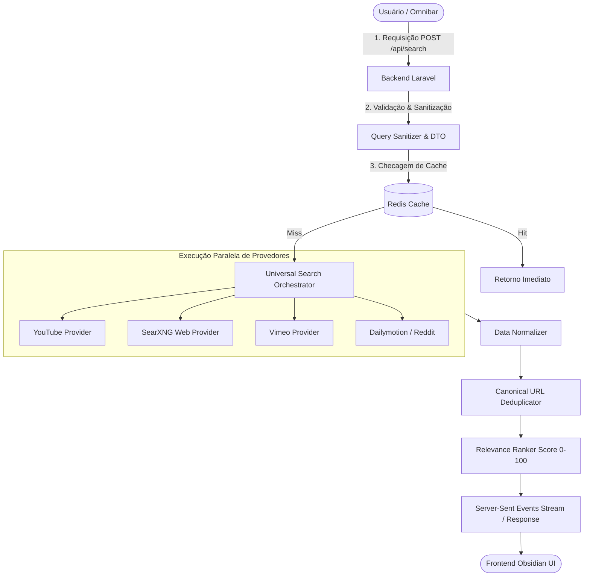

# DOCUMENTAÇÃO TÉCNICA E OPERACIONAL — VIDEOFINDER

> **Versão:** 1.0.0  
> **Status:** Especificação Arquitetural e Guia de Referência  
> **Identidade Visual:** Obsidian Signal Dark-Native System

---

## 1. Visão Geral da Plataforma

O **VideoFinder** é uma solução de busca universal de vídeos concebida para indexar, descobrir e analisar vídeos reais de diversas plataformas online. O sistema opera de forma totalmente independente de serviços pagos e não armazena arquivos pesados de terceiros, concentrando-se na inteligência de metadados, links diretos, legendas públicas e relevância semântica.

---

## 2. Requisitos de Ambiente

Para executar a aplicação localmente via Docker, seu ambiente deve atender aos seguintes requisitos mínimos:

- **Sistema Operacional:** Windows 10/11 com WSL2, Linux (Ubuntu 22.04+) ou macOS (Sonoma+).
- **Docker:** Versão 24.0 ou superior com Docker Compose v2.
- **Memória RAM Mínima:** 8 GB (16 GB recomendado caso execute modelos Ollama localmente em CPU).
- **Armazenamento:** Pelo menos 10 GB livres para imagens Docker e modelos locais compactos de embeddings.
- **Portas Necessárias:** `8080` (Proxy Nginx), `3000` (Next.js Dev opcional), `8000/9000` (Backend API), `3306` (MySQL), `6379` (Redis), `8081` (SearXNG), `11434` (Ollama).

---

## 3. Guia de Instalação Rápida

### 3.1 Clonagem e Preparação de Variáveis

1. Clone o repositório ou acesse a pasta raiz do projeto:
   ```bash
   cd d:/PROJETOS/cortes-youtube
   ```

2. Crie os arquivos de ambiente a partir do modelo:
   ```bash
   cp .env.example .env
   cp backend/.env.example backend/.env
   cp frontend/.env.example frontend/.env.local
   ```

3. Configure suas chaves gratuitas opcionais no `backend/.env` (como chave de desenvolvedor do YouTube Data API v3).

### 3.2 Inicialização dos Contêineres

Para construir e iniciar todos os serviços orquestrados:

```bash
docker compose up -d --build
```

O comando iniciará os seguintes contêineres:
- `videofinder-nginx`: Roteador principal em `http://localhost:8080`
- `videofinder-frontend`: Aplicação Next.js
- `videofinder-backend`: API Laravel PHP 8.3
- `videofinder-mysql`: Banco relacional MySQL 8
- `videofinder-redis`: Cache em memória e fila
- `videofinder-searxng`: Metabusca web independente
- `videofinder-ollama`: Servidor de IA local

### 3.3 Execução de Migrations e Seeds

Após a inicialização dos contêineres, execute as migrações do Laravel:

```bash
docker compose exec backend php artisan migrate --seed
docker compose exec backend php artisan key:generate
```

Acesse no navegador:
- **Aplicação Web (Frontend):** `http://localhost:8080/`
- **Documentação da API / Health Check:** `http://localhost:8080/api/health`
- **Painel Administrativo:** `http://localhost:8080/admin`

---

## 4. Dicionário de Variáveis de Ambiente

### 4.1 Raiz e Docker (`.env`)
```ini
APP_ENV=local
COMPOSE_PROJECT_NAME=videofinder
NGINX_PORT=8080
MYSQL_ROOT_PASSWORD=secret
MYSQL_DATABASE=videofinder
MYSQL_USER=videouser
MYSQL_PASSWORD=videopass
REDIS_PORT=6379
SEARXNG_PORT=8081
OLLAMA_PORT=11434
```

### 4.2 Backend Laravel (`backend/.env`)
```ini
APP_NAME=VideoFinder
APP_ENV=local
APP_KEY=
APP_DEBUG=true
APP_URL=http://localhost:8080

DB_CONNECTION=mysql
DB_HOST=videofinder-mysql
DB_PORT=3306
DB_DATABASE=videofinder
DB_USERNAME=videouser
DB_PASSWORD=videopass

CACHE_DRIVER=redis
REDIS_HOST=videofinder-redis
REDIS_PORT=6379

# Provedores de Vídeo (Chaves Gratuitas Oficiais)
YOUTUBE_API_KEY=sua_chave_gratuita_aqui
YOUTUBE_DAILY_QUOTA_LIMIT=9000

# Metabusca SearXNG
SEARXNG_URL=http://videofinder-searxng:8080

# Inteligência Artificial Local (Ollama)
OLLAMA_BASE_URL=http://videofinder-ollama:11434
OLLAMA_EMBEDDING_MODEL=nomic-embed-text
OLLAMA_LLM_MODEL=llama3.2:1b
AI_SEMANTIC_SEARCH_ENABLED=true
AI_TIMEOUT_SECONDS=5
```

### 4.3 Frontend Next.js (`frontend/.env.local`)
```ini
NEXT_PUBLIC_API_URL=http://localhost:8080/api
NEXT_PUBLIC_APP_NAME=VideoFinder
```

---

## 5. Configuração e Arquitetura dos Provedores

### 5.1 YouTube Data API v3
- **Como Obter Chave Gratuita:** Crie um projeto no Google Cloud Console, ative a *YouTube Data API v3* e gere uma chave de API gratuita (10.000 unidades diárias sem cobrança).
- **Gerenciamento de Quotas (Quota Guard):** Cada busca custa 100 pontos. O sistema mantém no Redis um contador diário. Ao atingir o limiar configurado (`YOUTUBE_DAILY_QUOTA_LIMIT`), o provedor YouTube desacelera e ativa o fallback automático para descoberta web via SearXNG (`site:youtube.com`), preservando a funcionalidade sem interrupções.

### 5.2 SearXNG (Descoberta Web Multirredes)
- O SearXNG atua como um metabuscador autohospedado que consulta agregadores públicos respeitando parâmetros de privacidade e sem limites de cartão de crédito.
- É utilizado para dorking estruturado em redes sociais que não fornecem APIs de busca abertas:
  - **TikTok:** `site:tiktok.com "expressão"`
  - **Instagram Reels:** `site:instagram.com/reel/ "termo"`
  - **Kwai:** `site:kwai.com "tema"`
  - **Facebook:** `site:facebook.com/watch/ "expressão"`
  - **Reddit:** `site:reddit.com/r/ "palavra-chave" video`
- Os links são capturados, validados contra padrões de URLs canônicas e normalizados.

### 5.3 Ollama e IA Semântica Local
- O contêiner `videofinder-ollama` permite carregar modelos abertos diretamente no seu computador sem enviar dados para APIs de terceiros.
- **Modelos Recomendados:**
  - Embeddings: `nomic-embed-text` (extremamente rápido e eficiente em CPU).
  - Expansão de Busca: `llama3.2:1b` ou `qwen2.5:0.5b`.
- **Comandos Úteis de Download no Ollama:**
  ```bash
  docker compose exec ollama ollama pull nomic-embed-text
  docker compose exec ollama ollama pull llama3.2:1b
  ```
- **Modo Fallback:** Caso o Ollama esteja desligado ou em computadores com recursos limitados, o VideoFinder executa instantaneamente a busca puramente textual por palavras-chave com relevância TF-IDF normalizada.

---

## 6. O Mecanismo Universal de Busca (Pipeline)



### Cálculo de Relevância (0 a 100):
- **Ocorrência exata no Título:** +40 pontos.
- **Ocorrência exata em Legendas/Transcrições:** +35 pontos.
- **Ocorrência na Descrição:** +15 pontos.
- **Similaridade Cosseno Semântica (Embeddings):** até +25 pontos.
- **Penalidade de Antiguidade (se filtro temporal ativo):** até -10 pontos.
- **Score Final:** Limitado ao intervalo normalizado `[0, 100]`.

---

## 7. Catálogo de Endpoints da API REST

A API segue padrões RESTful rigorosos com respostas JSON e autenticação via tokens do Laravel Sanctum.

### Pesquisa e Descoberta
- `POST /api/search`: Cria uma sessão de busca com parâmetros estruturados.
- `GET /api/search/{id}/results`: Recupera resultados paginados e filtrados de uma busca.
- `GET /api/search/{id}/stream`: Stream progressivo via Server-Sent Events (SSE).
- `GET /api/search/suggestions`: Auto-completar inteligente de termos e frases recorrentes.

### Detalhes do Vídeo e Transcrições
- `GET /api/videos/{id}`: Metadados consolidados de um vídeo específico.
- `GET /api/videos/{id}/transcript`: Legendas completas estruturadas em segmentos com minutagem (start, duration, text).
- `GET /api/videos/{id}/related`: Vídeos contextualmente semelhantes.

### Favoritos e Coleções (Usuários Autenticados)
- `GET /api/favorites`: Lista vídeos salvos pelo usuário autenticado.
- `POST /api/favorites`: Adiciona vídeo aos favoritos.
- `DELETE /api/favorites/{id}`: Remove vídeo dos favoritos.
- `GET /api/collections`: Retorna pastas e coleções temáticas.
- `POST /api/collections`: Cria nova coleção personalizada.
- `POST /api/collections/{id}/videos`: Adiciona vídeo à coleção.

### Administração e Saúde do Sistema
- `GET /api/admin/dashboard`: Telemetria de queries, cache hit rate e latência média.
- `GET /api/admin/providers`: Lista de provedores com status, cotas consumidas e circuit breaker.
- `POST /api/admin/providers/{id}/test`: Disparo de ping de diagnóstico para um conector.
- `GET /api/admin/quotas`: Visão consolidada de consumo de limites gratuitos.

---

## 8. Estrutura de Banco de Dados (Entidades Principais)

1. `users`: Dados de login, hash de senha, e-mail verificado e papel (`VISITANTE`, `USUARIO`, `ADMIN_MASTER`).
2. `providers`: Registro dos adaptadores disponíveis, status (`ativo`, `inativo`, `degradado`) e limites.
3. `provider_settings`: Chaves encriptadas de configuração e credenciais.
4. `search_sessions`: Sessões de pesquisa com UUID, termos de busca e filtros aplicados.
5. `search_results`: Tabela de associação entre sessões de busca e vídeos encontrados, com score e evidência.
6. `videos`: Metadados canônicos de vídeos (ID externo, plataforma, título, URL original, thumbnail, autor, duração).
7. `video_transcripts`: Cabeçalho de transcrições com idioma e autorização.
8. `video_transcript_segments`: Minutagem e trechos de áudio transcrito (`start_time`, `end_time`, `text`).
9. `favorites`: Associação de vídeos favoritos com usuários.
10. `collections`: Pastas temáticas criadas por usuários autenticados.
11. `collection_videos`: Relacionamento n:n entre coleções e vídeos.
12. `search_history`: Histórico de buscas do usuário com controle de privacidade.
13. `api_quota_usage`: Registro auditável de consumo de cotas gratuitas por provedor.

---

## 9. Diretrizes de Segurança e Boas Práticas

- **Proteção contra SSRF:** Todas as URLs fornecidas por usuários ou descobertas em scrapers passam por validação DNS e restrição estrita a domínios de provedores autorizados, bloqueando qualquer acesso a endereços privados (`127.0.0.1`, `10.0.0.0/8`, `192.168.0.0/16`, `169.254.169.254`).
- **Sanitização de Entradas e XSS:** Conteúdo de transcrições e descrições externas é purificado antes da renderização.
- **Rate Limiting:** Regras via Redis limitando visitantes anônimos a 30 pesquisas por hora e usuários autenticados a 120 por hora.
- **Encriptação de Credenciais:** Chaves de API de provedores armazenadas no MySQL são criptografadas com `APP_KEY` do Laravel (`Crypt::encryptString`).

---

## 10. Limitações Reais Conhecidas

1. **YouTube Quota:** O plano gratuito da Google Cloud oferece 10.000 pontos diários. Requisições pesadas de listagem consomem 100 pontos cada. O cache local do VideoFinder é projetado para minimizar o consumo.
2. **TikTok e Redes Restritas:** Sem contratos corporativos com as plataformas sociais, o sistema depende de páginas públicas indexadas via metabusca web. Metadados como visualizações em tempo real podem não estar disponíveis nesses casos.
3. **Legendas e Transcrições:** Nem todos os vídeos possuem legendas acessíveis. O sistema nunca inventa falas e informa claramente quando um trecho não pôde ser verificado em áudio real.

