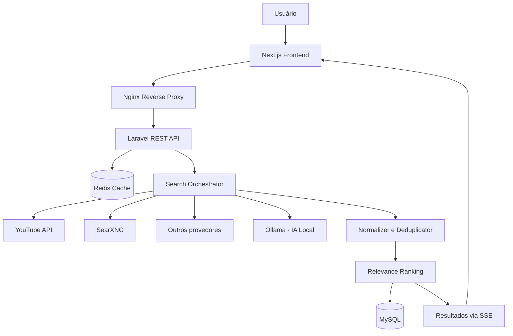

 
<div align="center">

# 🎬 VideoFinder

### Universal Video Search Engine

**Encontre vídeos, descubra conteúdos e localize falas exatas em diferentes plataformas da internet com o poder da Inteligência Artificial.**

Uma plataforma open-source de busca universal de vídeos, com pesquisa inteligente, análise semântica local, indexação de transcrições e resultados reais — sem depender de APIs pagas.


**[Visão Geral](#-sobre-o-projeto) • [Funcionalidades](#-principais-funcionalidades) • [Tecnologias](#-stack-tecnológica) • [Instalação](#-instalação-e-execução) • [Documentação](#-documentação)**

---

</div>

## 🌌 Sobre o Projeto

O **VideoFinder** nasceu com um objetivo: simplificar a maneira como encontramos vídeos na internet.

Atualmente, localizar um vídeo específico pode exigir pesquisas individuais em diversas plataformas, especialmente quando conhecemos apenas uma frase, uma fala, um assunto ou parte do conteúdo.

O VideoFinder propõe unificar essa experiência em um único mecanismo de pesquisa.

Com uma arquitetura modular, motores de busca gratuitos e inteligência artificial executada localmente, a plataforma foi projetada para oferecer resultados relevantes, verificáveis e organizados.

### 🎯 O que você poderá pesquisar?

- 🔎 **Palavras-chave:** encontre vídeos relacionados a um termo ou expressão.
- 💬 **Frases específicas:** pesquise trechos de falas presentes em transcrições disponíveis.
- 🧠 **Linguagem natural:** descreva o vídeo que deseja encontrar.
- ⏱️ **Timestamps:** identifique o momento exato de determinada fala, quando houver transcrição acessível.
- 🌐 **Múltiplas plataformas:** pesquise vídeos provenientes de diferentes fontes.
- 👤 **Criadores e canais:** descubra conteúdos por autor ou contexto.
- 🎯 **Busca semântica:** encontre resultados relacionados ao significado da pesquisa, não apenas às palavras digitadas.

> **Princípio fundamental:** o VideoFinder não inventa vídeos, links ou transcrições. A IA auxilia na interpretação, classificação e relevância de conteúdos reais.

---

## ✨ Principais Funcionalidades

### 🔍 Universal Video Search

Um mecanismo de pesquisa que consulta diferentes provedores por meio de adaptadores independentes.

**Recursos previstos:**

- Pesquisa textual unificada.
- Busca por correspondência exata.
- Consultas simultâneas a múltiplos provedores.
- Deduplicação automática de resultados.
- Normalização de metadados.
- Filtros e ordenação por relevância.
- Cache inteligente para otimização de consultas.
- Resultados progressivos utilizando Server-Sent Events (SSE).

### 🧠 AI-Powered Semantic Search

Integração com **Ollama**, permitindo executar modelos de inteligência artificial diretamente na infraestrutura local.

A IA será utilizada para:

- Interpretar pesquisas em linguagem natural.
- Expandir consultas com termos semanticamente relacionados.
- Identificar sinônimos e conceitos semelhantes.
- Calcular similaridade por embeddings.
- Melhorar o ranqueamento dos resultados.

**Modelos previstos:**

| Modelo | Finalidade |
|---|---|
| `nomic-embed-text` | Geração de embeddings |
| `llama3.2:1b` | Interpretação e expansão de consultas |
| `qwen2.5:0.5b` | Alternativa compacta de modelo de linguagem |

A busca textual continuará disponível mesmo quando a IA local estiver desabilitada.

### 🎙️ Transcript Intelligence

Mecanismo de consulta e exploração de legendas e transcrições públicas acessíveis.

**Funcionalidades previstas:**

- Pesquisa por frases dentro das transcrições.
- Exibição de segmentos de texto com minutagem.
- Destaque visual das palavras encontradas.
- Navegação diretamente ao momento correspondente do vídeo.
- Inspeção das legendas em painel lateral.

A disponibilidade das transcrições depende das permissões e dos recursos oferecidos por cada plataforma.

### ⚡ Real-Time Search Experience

Os resultados poderão ser apresentados progressivamente, sem necessidade de aguardar a conclusão de todas as fontes.

Tecnologias utilizadas no planejamento:

- Server-Sent Events (SSE).
- Redis Cache.
- Processamento concorrente de provedores.
- Circuit Breaker.
- Timeouts individuais.
- Fallback automático entre mecanismos de descoberta.

### 📂 Organização de Conteúdos

Ferramentas planejadas para usuários autenticados:

- Favoritos.
- Coleções personalizadas.
- Histórico de pesquisas.
- Organização de vídeos por temas.
- Consulta de vídeos relacionados.

### 📊 Dashboard Administrativo

Interface para gerenciamento e monitoramento da plataforma.

- Status dos conectores.
- Consumo de cotas gratuitas.
- Estatísticas de pesquisas.
- Taxa de acertos do cache.
- Latência dos provedores.
- Diagnóstico de integrações.
- Configurações de mecanismos de busca.

---

## 🌍 Plataformas de Busca

A arquitetura foi planejada para descobrir vídeos públicos nas seguintes plataformas:

| Plataforma | Estratégia prevista | Integração |
|---|---|---|
| YouTube | YouTube Data API v3 + SearXNG | API gratuita / Web |
| TikTok | Descoberta por páginas públicas indexadas | SearXNG |
| Instagram Reels | Descoberta por páginas públicas indexadas | SearXNG |
| Vimeo | API de desenvolvedores + busca web | API / Web |
| Dailymotion | API REST pública | API |
| Twitch | Twitch Helix API | API |
| Reddit | API / Endpoints JSON públicos | API / Web |
| Facebook Videos | Descoberta web | SearXNG |
| Kwai | Descoberta web | SearXNG |
| Outros sites | Pesquisa web indexada | SearXNG |

> **Nota:** suporte planejado não significa cobertura garantida. Algumas plataformas restringem APIs, indexação e acesso a metadados. O VideoFinder respeitará essas limitações.

---

## 🛠️ Stack Tecnológica

O projeto utiliza uma arquitetura **Full Stack moderna, modular e conteinerizada**.

### Frontend


- Next.js 14+ com App Router.
- React e TypeScript.
- Tailwind CSS.
- shadcn/ui.
- TanStack Query.
- Zustand.
- Server-Side Rendering (SSR).

### Backend


- PHP 8.3.
- Laravel 11.
- REST API.
- Laravel Sanctum.
- Adapter Pattern.
- Jobs, Queues e Scheduler.
- Validação e normalização de dados.

### Banco de Dados, Cache e IA


- MySQL 8.0 — persistência relacional.
- Redis — cache, controle de concorrência e filas.
- SearXNG — metabusca autogerenciada.
- Ollama — processamento de IA local.

### Infraestrutura


- Docker.
- Docker Compose.
- Nginx Reverse Proxy.
- Monorepo.
- Serviços independentes.

---

## 🏗️ Arquitetura do Sistema

O VideoFinder foi projetado como um monorepo distribuído em serviços Docker.



### 🔄 Pipeline de Pesquisa

1. **Query Processing:** interpretação e sanitização da consulta.
2. **Cache Lookup:** verificação de resultados existentes no Redis.
3. **Semantic Expansion:** expansão contextual opcional via Ollama.
4. **Provider Dispatch:** pesquisa paralela nos provedores habilitados.
5. **Data Normalization:** padronização de metadados.
6. **Deduplication:** eliminação de URLs e vídeos duplicados.
7. **Relevance Ranking:** atribuição de pontuação de 0 a 100.
8. **Progressive Delivery:** transmissão de resultados via SSE.

---

## 🎨 Design System — Obsidian Signal

A identidade visual do VideoFinder utiliza o **Obsidian Signal**, um design system dark-native inspirado em ferramentas modernas de produtividade e desenvolvimento, como Linear e Raycast.

### 🎨 Paleta de Cores

| Elemento | Cor | Hex |
|---|---|---|
| Background | Near Black | `#09090B` |
| Background secundário | Dark Zinc | `#131316` |
| Cards | Zinc Surface | `#18181B` |
| Bordas | Zinc Border | `#27272A` |
| Primária | Electric Violet | `#8B5CF6` |
| Secundária | Hyper Cyan | `#06B6D4` |
| Alertas | Crimson Coral | `#F43F5E` |

### 🔤 Tipografia

- **Plus Jakarta Sans:** títulos e elementos de destaque.
- **Inter:** textos, formulários e componentes.
- **JetBrains Mono:** timestamps, métricas e dados técnicos.

### 🖥️ Componentes de Interface

- Omnibar de pesquisa com atalhos de teclado.
- Sidebar fixa de navegação.
- Cards de vídeo em proporção 16:9.
- Transcript Inspector com painel deslizante.
- Indicadores visuais de correspondência.
- Dashboard analítico.
- Estados de loading, sucesso e falha.
- Componentes responsivos.

Os protótipos e referências visuais encontram-se em:

**[`uxui/`](uxui/)**

Diretrizes detalhadas de design:

**[`uxui/obsidian_signal/DESIGN.md`](uxui/obsidian_signal/DESIGN.md)**

---

## 📁 Estrutura do Projeto

```text
videofinder/
│
├── frontend/                  # Next.js + React + TypeScript
│
├── backend/                   # Laravel REST API
│
├── infrastructure/
│   ├── nginx/                 # Reverse Proxy
│   ├── searxng/               # Metabusca web
│   └── docker/                # Configurações Docker
│
├── uxui/                      # Protótipos e Design System
│
├── docs/                      # Diagramas e OpenAPI
│
├── docker-compose.yml         # Orquestração
├── CONTEXTO.md                # Contexto arquitetural
├── DOCUMENTACAO.md            # Documentação técnica
├── PASSOS.md                  # Roadmap de implementação
├── PROMPT.md                  # Especificação mestre
└── README.md                  # Apresentação do projeto
```

A estrutura representa a organização arquitetural planejada e poderá ser expandida durante o desenvolvimento.

---

## 🚀 Instalação e Execução

> **Atenção:** os comandos abaixo representam o procedimento de instalação previsto. O projeto ainda está na fase de planejamento, e os serviços dependerão da implementação dos arquivos e contêineres correspondentes.

### Pré-requisitos

| Requisito | Especificação |
|---|---|
| Sistema operacional | Windows 10/11 + WSL2, Linux ou macOS |
| Docker | 24.0+ |
| Docker Compose | v2 |
| RAM | Mínimo 8 GB |
| RAM recomendada com IA | 16 GB |
| Armazenamento | 10 GB livres |

### 1. Prepare o repositório

Na raiz do projeto, copie os arquivos de ambiente:

```bash
cp .env.example .env
cp backend/.env.example backend/.env
cp frontend/.env.example frontend/.env.local
```

Configure as variáveis necessárias conforme a documentação.

### 2. Inicie a infraestrutura

```bash
docker compose up -d --build
```

### 3. Configure o banco de dados

```bash
docker compose exec backend php artisan key:generate
docker compose exec backend php artisan migrate --seed
```

### 4. Configure os modelos locais de IA

```bash
docker compose exec ollama ollama pull nomic-embed-text
docker compose exec ollama ollama pull llama3.2:1b
```

### 5. Acesse a aplicação

Quando os serviços estiverem implementados e disponíveis:

| Serviço | Endereço planejado |
|---|---|
| Aplicação Web | http://localhost:8080 |
| API Health Check | http://localhost:8080/api/health |
| Painel Administrativo | http://localhost:8080/admin |

### Comandos úteis

**Acompanhar logs:**

```bash
docker compose logs -f
```

**Verificar contêineres:**

```bash
docker compose ps
```

**Parar os serviços:**

```bash
docker compose down
```

Para informações detalhadas de configuração, consulte [`DOCUMENTACAO.md`](DOCUMENTACAO.md).

---

## 🔌 REST API

O backend será responsável pela comunicação com os provedores, persistência, controle de autenticação e gerenciamento das consultas.

### Endpoints Planejados

| Método | Endpoint | Descrição |
|---|---|---|
| `POST` | `/api/search` | Iniciar pesquisa |
| `GET` | `/api/search/{id}/results` | Listar resultados |
| `GET` | `/api/search/{id}/stream` | Streaming SSE |
| `GET` | `/api/search/suggestions` | Sugestões de busca |
| `GET` | `/api/videos/{id}` | Detalhes do vídeo |
| `GET` | `/api/videos/{id}/transcript` | Transcrição |
| `GET` | `/api/videos/{id}/related` | Vídeos relacionados |
| `GET` | `/api/favorites` | Favoritos |
| `GET` | `/api/collections` | Coleções |
| `GET` | `/api/admin/dashboard` | Dashboard administrativo |
| `GET` | `/api/admin/providers` | Status dos provedores |
| `GET` | `/api/admin/quotas` | Cotas de integrações |

A autenticação será baseada em Laravel Sanctum.

Os contratos completos e eventuais alterações serão documentados na especificação OpenAPI.

---

## 🛡️ Segurança e Privacidade

A arquitetura prioriza segurança, conformidade e tratamento responsável dos dados.

**Proteções planejadas:**

- Validação de entrada e sanitização de consultas.
- Mitigação de SSRF e restrição de domínios.
- Proteção contra XSS.
- Rate limiting via Redis.
- Credenciais criptografadas no backend.
- Autenticação com Laravel Sanctum.
- Controle de acesso por papéis.
- Tratamento de URLs externas.
- Respeito aos termos de uso dos provedores.
- Não armazenamento dos arquivos originais de vídeo de terceiros.

### Limites de Pesquisa Planejados

| Perfil | Limite |
|---|---|
| Visitante | 30 pesquisas/hora |
| Usuário autenticado | 120 pesquisas/hora |

Os limites poderão ser configurados conforme os recursos disponíveis na infraestrutura.

---

## 💡 Filosofia do Projeto

O VideoFinder segue cinco princípios fundamentais:

**01. Open Source First**

Arquitetura aberta, extensível e preparada para execução autogerenciada.

**02. Zero Paid Dependencies**

Prioridade para APIs gratuitas, ferramentas de código aberto e modelos de IA locais.

**03. Real Data Only**

Resultados autênticos, links verificáveis e nenhuma geração artificial de metadados inexistentes.

**04. Resilience by Design**

Fallback entre provedores, cache e tratamento de indisponibilidade.

**05. Privacy & Compliance**

Respeito às restrições técnicas, privacidade dos usuários e regras das plataformas consultadas.

---

## ⚠️ Limitações Conhecidas

O projeto considera as limitações dos serviços externos desde a arquitetura inicial.

- **Cotas de API:** provedores como YouTube possuem limites diários de utilização.
- **Redes sociais restritas:** TikTok, Instagram e outras plataformas podem limitar a descoberta de conteúdo público.
- **Transcrições:** nem todos os vídeos possuem legendas disponíveis ou autorizadas para consulta.
- **IA local:** desempenho variável conforme CPU, RAM e GPU.
- **Metadados:** métricas como visualizações e duração podem não estar disponíveis para todas as fontes.
- **Metabusca:** resultados dependem das páginas indexadas e da disponibilidade dos mecanismos externos.

O VideoFinder foi planejado para informar dados indisponíveis, sem simular informações.

---

## 🗺️ Roadmap

### Status Geral

**Planejamento e arquitetura concluídos — desenvolvimento aguardando início.**

| Etapa | Descrição | Status |
|---|---|---|
| Planejamento | Definição de requisitos | ✅ Concluído |
| Arquitetura | Estrutura de serviços e integrações | ✅ Concluído |
| Design System | Protótipos Obsidian Signal | ✅ Catalogado |
| Documentação | Especificações técnicas e governança | ✅ Concluído |
| Etapa 1 | Docker, Next.js e Laravel | ⏳ Pendente |
| Etapas seguintes | Implementação conforme `PASSOS.md` | ⏳ Pendente |

O roteiro completo de desenvolvimento está disponível em:

**[`PASSOS.md`](PASSOS.md)**

---

## 📚 Documentação

O repositório mantém uma estrutura documental para facilitar manutenção, continuidade de desenvolvimento e colaboração.

| Documento | Descrição |
|---|---|
| 📘 [CONTEXTO.md](CONTEXTO.md) | Visão geral, arquitetura, decisões técnicas e status do projeto |
| 📗 [DOCUMENTACAO.md](DOCUMENTACAO.md) | Instalação, configuração, APIs, banco de dados, segurança e operação |
| 📙 [PASSOS.md](PASSOS.md) | Roadmap sequencial com etapas e critérios de aceitação |
| 📕 [PROMPT.md](PROMPT.md) | Especificação mestre dos requisitos do sistema |
| 🎨 [uxui/](uxui/) | Protótipos, telas e referências visuais |

---

## 🤝 Contribuições

Contribuições, sugestões e melhorias serão bem-vindas durante a evolução do projeto.

Você poderá colaborar por meio de:

1. Abertura de issues para relatar problemas ou sugerir funcionalidades.
2. Discussões sobre arquitetura e integrações.
3. Desenvolvimento de novos conectores e provedores.
4. Melhorias de desempenho e acessibilidade.
5. Pull requests com correções e novas implementações.

Antes de contribuir, consulte a documentação e verifique o estágio atual de desenvolvimento.

---

## 📄 Licença

O VideoFinder tem como objetivo ser um projeto open-source.

A licença de distribuição deverá ser formalizada em um arquivo `LICENSE` antes da publicação oficial sob uma licença específica.

---

<div align="center">

### 🎬 VideoFinder

**Search Beyond Keywords. Discover Beyond Platforms.**

*Encontre mais. Pesquise melhor. Descubra sem limites artificiais.*

---

**Built with Next.js • Laravel • Docker • SearXNG • Ollama**


</div>
